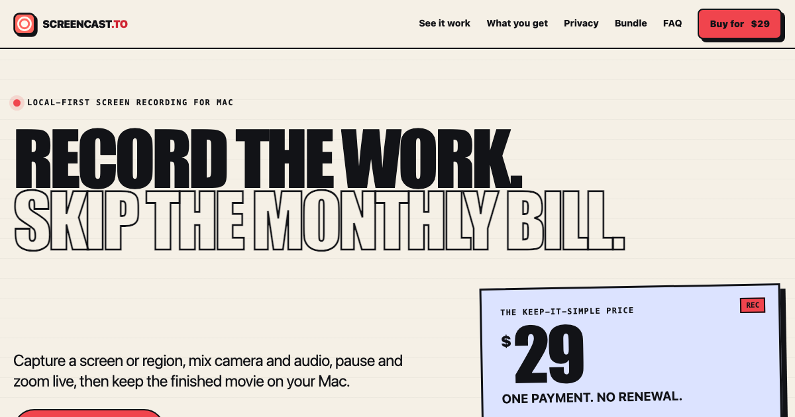

<p align="center">
  
</p>

<h1 align="center">Screencast.to</h1>

<p align="center">
  A local-first Mac screen recorder for demos, walkthroughs, and bug reports.<br>
  Record the work. Skip the monthly bill.
</p>

<p align="center">
  <a href="https://screencast.to">Website</a> ·
  <a href="https://screencast.to/bundle/">Bundle preview</a> ·
  <a href="SECURITY.md">Security</a> ·
  <a href="CONTRIBUTING.md">Contributing</a>
</p>



> **Distribution:** the website edition uses Stripe checkout, private signed
> downloads, and Sparkle updates. Website purchasers can connect optional cloud
> sharing to their Mac. The Mac App Store edition uses Apple's purchase and
> update flow.

## What it does

- Records a full display or a selected region from the macOS menu bar.
- Mixes optional camera, microphone, and system audio.
- Supports pause/resume, live zoom, camera layouts, and a local teleprompter.
- Saves a normal movie to a user-selected location through the standard macOS Save dialog.
- Uploads only after an explicit sharing action; core recording is local.
- Uses no Screencast account, advertising SDK, or behavioral analytics.

Requires macOS 15 or later on Apple silicon or Intel.

Choose **Presenter** in the recording Format menu to remove your camera
background and place your cutout at the bottom center of the screen or selected
region. The camera fits within the bottom half without cropping or stretching,
in landscape or portrait (including 9:16 Shorts / Reels). Move naturally within
your camera's view; the overlay stays fixed and clicks pass through it. Background
removal runs on your Mac. Switch formats while recording with **⌘⇧C**.

## Architecture

| Area | Implementation |
|---|---|
| Mac app | Swift and SwiftUI, with ScreenCaptureKit and AVFoundation |
| Product site | Static HTML, CSS, and JavaScript in `checkout/` |
| Hosted service | One Cloudflare Worker in `worker/` |
| Temporary sharing | Verified StoreKit or website purchases, 15-minute upload authorization, and lifecycle-managed R2 storage |
| Direct sales | Stripe Checkout with purchaser-only downloads from private R2 storage |
| Website purchase connection | Browser verification or email recovery, a one-use app callback, and an opaque grant stored in the Mac Keychain |
| Purchase recovery email | Cloudflare Email Service through a native Worker binding and verified sending domain |
| Standalone updates | Sparkle 2 with an EdDSA-signed, token-gated private feed |
| App Store updates | Apple-managed; the App Store target contains no Sparkle framework |

Production uses `screencast.to`, `www.screencast.to`, and
`share.screencast.to`. See [the architecture guide](docs/ARCHITECTURE.md) for
the request flows and trust boundaries.

## Repository layout

- `screencast/` — macOS application source and resources.
- `screencast.xcodeproj/` — App Store and standalone build targets.
- `checkout/` — product site, policies, browser code, and private-release
  publishing client.
- `worker/` — Cloudflare APIs, sharing pages, commerce, and R2 access.
- `scripts/` — App Store and Developer ID release scripts.
- `LICENSES/` and `THIRD_PARTY_NOTICES.md` — current and historical license
  records.

## Development

Requirements: macOS 15+, Xcode 26+, and Node.js 24+.

Build the Mac targets without signing:

```sh
xcodebuild -project screencast.xcodeproj -scheme screencast \
  -configuration Debug -destination 'platform=macOS' \
  CODE_SIGNING_ALLOWED=NO build

xcodebuild -project screencast.xcodeproj -scheme screencast-standalone \
  -configuration Debug -destination 'platform=macOS' \
  CODE_SIGNING_ALLOWED=NO build
```

Check presenter transparency, framing, and format cycling without a camera:

```sh
scripts/check-presenter.sh
```

Check the website and Worker:

```sh
npm --prefix checkout ci
npm --prefix checkout test
npm --prefix checkout run build

npm --prefix worker ci
npm --prefix worker run check
npm --prefix worker test
npm --prefix worker run smoke
```

Run `npm --prefix checkout start` for a safe static preview. It deliberately
keeps checkout disabled. Use `npm --prefix worker run dev` when testing the
Cloudflare APIs and static assets together.

## Distribution

Screencast.to has two independent release channels:

- The **Mac App Store build** is sandboxed, uses Apple for purchases and
  updates, and may use the first-party temporary-sharing service.
- The **website build** is Developer ID-signed and notarized, is sold through
  Stripe as a one-time purchase, and receives signed Sparkle updates. Purchasers
  can connect temporary sharing through the app's browser-based purchase flow.

Pushing a valid `vMAJOR.MINOR.PATCH` tag starts the private standalone release
workflow. It builds and notarizes the DMG, generates the signed appcast, and
publishes immutable release objects to private Cloudflare R2 storage. It does
not create a public GitHub Release.

Local release commands and required credentials are documented in
[`scripts/.env.example`](scripts/.env.example),
[`checkout/README.md`](checkout/README.md), and
[`worker/README.md`](worker/README.md).

## Temporary sharing

In the official website edition, choose **Connect sharing** in Screencast.
The browser verifies the purchase cookie from Stripe checkout. If that cookie
is missing, enter the checkout email to receive a short-lived, single-use
purchase link. You can also [recover a website purchase](https://screencast.to/connect-sharing.html)
to regain download access after changing browsers or clearing cookies.
Recovery email uses Cloudflare Email Service and becomes available only after
outbound sending is verified and explicitly enabled; see the
[Worker setup](worker/README.md#website-purchase-recovery-email).

After verification, choose **Connect sharing**, then **Open Screencast** to
finish connecting the requesting Mac. A one-use code is bound to that app's
verification challenge and state. The Mac stores the resulting opaque sharing
grant in Keychain and keeps 15-minute upload tokens in memory. Each token
refresh rechecks the Stripe purchase and rejects refunded or disputed payments.
**Disconnect this Mac** removes the saved grant and cached authorization.

The App Store edition continues to verify its Apple-signed StoreKit purchase
proof to obtain the same short-lived upload authorization. Neither flow needs
a Screencast account or embeds a first-party upload credential in the app.
Connecting never uploads a recording: uploads happen only when you explicitly
choose **Upload**. Links are unlisted, accessible to anyone with the URL, and
recordings are normally deleted within 24–48 hours by storage lifecycle rules.

## Privacy and security

Recordings remain local unless the user chooses to upload one. Public source
builds have first-party hosted sharing disabled by default. Self-hosted builds
must use their own Worker, R2 bucket, routes, and credentials.

Do not commit environment files, signing identities, App Store transaction
proofs, service tokens, Stripe keys, Sparkle private keys, or private recording
links. Report vulnerabilities through the process in [SECURITY.md](SECURITY.md).

## Contributing

Bug reports and focused pull requests are welcome. Contributions require the
additional grant described in [CONTRIBUTING.md](CONTRIBUTING.md) so the project
owner can continue distributing both public-source and paid builds.

## License

Current project-owned source is publicly available under
[PolyForm Noncommercial 1.0.0](LICENSE). This is a source-available license,
not an OSI-approved open-source license: personal and other permitted
noncommercial uses are allowed, while commercial use requires separate
permission.

Earlier snapshots retain the licenses granted at the time; those historical
MIT, Apache-2.0, and PolyForm Shield grants are not revoked. See
[THIRD_PARTY_NOTICES.md](THIRD_PARTY_NOTICES.md) and
[TRADEMARKS.md](TRADEMARKS.md).
